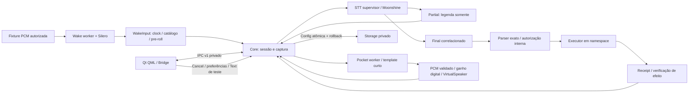

# Mapa da Base para S2

Escopo: implementação nova em `base`, S1, cliente B1, preferências B2.1, modo seguro B2.2a pack interno B2.2b feedback/ganho B2.3 e descoberta/aprovação Hub B3.1/B3.2a.
Contratos e evidências atuais de B2: docs/B2.md e docs/evidence/b2-feedback.json e docs/evidence/b3-catalog.json.
Fonte: código atual, specs S1/S2 em docs/sources, inferência CPU com fixtures,
IPC real e Qt offscreen. Não é um mapa de prontidão física ou do legado.

## Onde fica cada responsabilidade

| Arquivo | Responsabilidade | Limite relevante para a UI |
|---|---|---|
| src/main.rs | Flags/perfil e entrada do daemon | App não inicia/desliga Core por fechar janela |
| src/storage.rs | Root 0700, arquivos 0600, singleton/config/audit | Config v1: feedback/visual/ganho/prazo em idle, CAS/rollback; conteúdo inválido→safe mode; recuperação→restart |
| src/hub.rs | Catálogo offline v1 pinado por SHA, schema/limites/compatibilidade | Sem instalação/execução; permissões declaradas não são grants; publisher não verificado |
| src/pack.rs | Pack v1, hashes/proveniência/modelos e catálogo | DEV qualificado não é freeze/certificação física; sem Model Manager |
| src/protocol.rs | Request/Response/Event e esquema estrito | v1, IDs e erros são contratos; não enviar grants |
| src/transport.rs | SO_PEERCRED, peers, filas, tarefas, namespace, sinais | Processos internos supervisionados; sem dispositivo pessoal |
| src/core.rs | Único owner de sessão/deadline/autoridade/resultado | UI representa fatos, não replica decisões |
| src/audio.rs | Frame/source/sink virtuais | Entrada mono 16k; CPAL/PipeWire físicos ausentes |
| src/wake.rs + scripts/wake_worker.py | Catálogo, clock, cooldown, ring 1s, KWS CPU | Frase suportada não equivale a qualidade qualificada |
| src/capture.rs | PCM efêmero, endpoint/silêncio/duração | Máx 30s incluindo pre-roll; sem WAV de voz persistido |
| src/stt.rs + scripts/stt_worker.py | Streaming e lifecycle do SDK | Partial jamais autoriza; raw/normalized distintos |
| src/commands.rs + scripts/command_worker.py | Gramática/policy/grant/executor/receipt | App fixture realmente executa; navegador pessoal não |
| src/tts.rs + scripts/tts_worker.py | Template/engine CPU/PCM e sink virtual | Ganho/hash/pico/RMS verificados nos bytes consumidos; sem playback físico comprovado |
| app/bridge.py | Transporte Qt, validação, delta/reconnect e projeção | Session u64 é string em QML; estado velho é apagado |
| app/main.py / Main.qml / GlassCard.qml / GlowButton.qml / visual.py | Sidebar/rotas, tema de janela, esfera/raster software, HUD, legenda, resultado e Cancel | Qt thin; leitura mínima e acessibilidade offscreen testadas |
| scripts/provision_tts.py | Provisionamento de assets por revisões fixas | Ferramenta de engenharia, não Model Manager de produto |
| scripts/graph.py | Graphify AST isolado | QML não indexado; revisar QML/fazer teste runtime diretamente |

## Estado visível e sua interpretação

| state | Fonte/acontecimento | O que mostrar | O que não inferir |
|---|---|---|---|
| idle | Nenhuma sessão ativa | Em espera + saúde dos motores | Não implica microfone armado nem engines saudáveis |
| capturing | Wake/VirtualWake abriu sessão ou captura | Ouvindo; Cancel disponível | Não implica gravação em disco |
| transcribing | Captura encerrada, Final pendente | Finalizando transcrição | Partial pode já existir durante capturing |
| executing | Comando tipado autorizado aguardando receipt | Executando | Não mostrar sucesso antecipado |
| speaking | Resultado determinado, TTS/sink em andamento | Preparando/Respondendo + progresso | Ainda não significa áudio concluído ou speaker físico |
| offline (cliente) | IPC inválido/desconectado/watchdog | Erro/reconectando; desabilitar ações | Não tratar como estado do Core |

WakeDetected existe como ocorrência interna de ativação, não como State separado
no protocolo. session_started também ocorre por texto/VirtualWake: a UI não deve
inferir wake físico apenas pelo nome do evento. Confirm não tem backend ativo;
não oferecer diálogo de confirmação com autoridade fictícia. Error de motor é
ortogonal a state: Core pode estar idle e stt_status=failed. Na UI, health de
configuração projeta safe_mode/restart_required na Aura; wire state permanece
idle e session_id=null nesses modos, sem alegar atividade de áudio.

## Dicionário de IPC usado pelo App

| Campo | Uso/condição |
|---|---|
| version / request_id | Validar handshake e correlação antes de Conectado |
| sequence / events | Sequência crescente; ring de 64 eventos, não histórico completo |
| session_id | u64 numérico no wire/Python; string na UI, sem JS double |
| state | Fase atual canônica; fases breves podem passar entre snapshots |
| transcript.source | voice ou user_text; não apresentar texto como STT real |
| transcript.raw / normalized / is_final / revision | Legenda; normalização só whitespace; confidence Unknown |
| transcript.audio_end_us | Clock PCM; Core recusa futuro e Final que não cobre todo PCM aceito |
| capture | Intervalo/contagem/hash/reason; prova de bytes, não qualidade acústica |
| command.code / receipt | Sucesso só com efeito verificado; falha/timeout sem prova de sucesso |
| speech_status / speech_samples / speech | Progresso/conclusão; cancel/failed não produzem summary concluído |
| wake_status / stt_status | Saúde/disponibilidade; replay_finished não significa listener armado |
| text_input_available | Test-only, exige --virtual-input + --commands-sandbox |
| preferences | Config efetiva, revisão u64 e anteriores incluindo wake para rollback; em safe mode são padrões de recuperação |
| base_pack | Catálogo do pack, engine IDs, qualificação, texto explícito, perfil no processo/default, voz/idioma/áudio virtual; sem paths |
| configuration_status / configuration_recovery_available | ready/safe_mode/restart_required; somente conteúdo privado inválido pode ser recuperado |
| code | Resultado do request; distinto de resultado da ação e resultado de fala |

Snapshot, Cancel, Text de teste, VirtualWake de teste, Action negada, Preferences
e RollbackPreferences; SelectWake exige ID DEV qualificado e idle/revisão.
RecoverConfiguration só em safe mode com revisão do boot.
Config exige idle e revisão atual; App não escreve disco.
Discovery está em base_pack do Snapshot quando --base-pack é fornecido;
Install e VoiceDevices físicos ainda não têm endpoints.
Incoming frame 4096B, UI response até 65536B; 8 peers/16 calls. Um request Qt em
voo, active poll 150ms, idle 1s; watchdog 2s; reconnect 0.5–5s. Delta ignora
request_id. Invalidez de payload aninhado/deep JSON limpa estado e revoga controles.

## Perfis, catálogo e controles

| Recurso | Estado real | Decisão para S2 |
|---|---|---|
| Hey Gideon | KWS default qualificado em corpus DEV | Rotular escopo DEV, sem precisão física garantida |
| Okay Gideon | Suportado pelo KWS; qualidade POC_REQUIRED; STT pode escrever K Gideon | Não promover a frase certificada por existir no catálogo |
| Frase arbitrária | Parser aceita texto configurado; KWS precisa pack/treino adequado | Input livre de wake não é funcionalidade pronta |
| STT | Moonshine Small EN streaming | Não oferecer idioma pt-BR como comprovado |
| TTS/voz | Pocket EN 2026-09 + Alba, primeiro candidato | Uma voz local pinada; comparações Piper/Kokoro pendentes |
| Dispositivos | Fixture/virtual source/sink | CPAL/PipeWire/hotplug/AEC/barge-in precisam implementação/validação |
| Ganho da resposta TTS | 0–100% no sink virtual; 0 não cria job TTS | Não altera mixer nem volume do dispositivo do host |
| Indicador visual | Config bool, oculta só o círculo decorativo | Estado textual/Cancel/erros/resultados continuam visíveis |
| Volume/mute command | Estado simulado por invocação em tmpfs | Não usar receipt como volume atual do host |
| Open app | Desktop ID allowlist → app fixture | Não afirmar que Brave real ou janela Wayland abriu |
| Hora/data | UTC no executor sandbox | Não prometer timezone configurável antes de suporte |
| Hub / Plugins | Catálogo local lido e exibido; instalação/execução ausentes | Publisher não autenticado; checksum verifica só os bytes do catálogo |
| LLM / Skills / Connections | Não implementados | Nenhum painel Models/LLM até plugin S3 |

## Dependências antes de B2/B3/B4

1. B2.2b: pack interno faz discovery/preflight de perfis/assets e liga relatórios
   por hash/engine/frase/config do KWS. UI recebe IDs/texto explícito/qualificação,
   Alba/EN candidato e áudio virtual. Sem pack, perfis de engenharia conservam
   compatibilidade e inferem prefixo pelo label; App não oferece seletor certificado.
2. B2.1: feedback/prazo têm API actor-owned, revisão, idle-only, persistência e
   rollback atômicos. B2.2a preserva conteúdo inválido em safe mode: sem engines
   ou comandos; recuperação privada só ativa recursos depois do reinício real.
   Arquivos inseguros ainda recusam boot. B2.2b salva wake qualificado e rollback
   no mesmo JSON; seleção/troca exige reinício. Incompatível com pack→safe mode.
3. B2.3: feedback audível/visual, ganho e prazo alteram o fluxo real. Ganho é
   aplicado no PCM validado antes de hash/pico/RMS; mute evita worker. Revision,
   idle-only e rollback/restart compartilhados; visual não oculta estado/Cancel.
   Voz/idioma/sensibilidade/performance são fixos no perfil suportado e rotulados,
   sem controles falsos; língua da UI (PT) distinta de ASR/TTS (EN).
4. B2: recuperação de conexão já existe; recuperação de worker exige restart do
   Core atualmente. Não anunciar auto-recovery de engine nem deixar UI ser daemon.
5. B3.1: --hub-catalog recebe arquivo absoluto + SHA; parse bounded estrito,
   compatibilidade API/target e dependências pendentes, descoberta Core→Qt. Falha
   coloca somente catálogo em quarentena; Base continua. Nenhum binário baixado
   ou instalado. B3.2a aprova permissões exatas via Core/IPC/Qt, vinculadas ao manifest e catálogo,
   com revisão/persistência privada/restart; não concede grants Base. B3.2b/3.3
   ainda precisam bytes/staging, update/rollback/removal em namespace e audit.
6. B4: paths de workers usam CARGO_MANIFEST_DIR e assets/venvs do workspace;
   relocalização/pacote offline/lifecycle precisam trabalho antes de distribuição.
   Nenhum Flatpak/portal/auto-login do host foi instalado ou validado.

## Limites de prontidão

S1 e B1 têm evidência automática de integração, não certificação física. Adapters
CPAL/PipeWire/AEC/hotplug/barge-in ausentes são trabalho de implementação, não
apenas um teste humano pendente. Frase alternativa, WER amplo/holdout e pt-BR também
não estão fechados. Primeiro PCM frio do Pocket ~8s e pico de RSS ~1.5GB continuam
questões de desempenho. Modelo vencedor não foi congelado.

O fechamento B2 considera somente as preferências disponíveis no perfil
virtual/qualificado DEV; devices/performance/freeze físicos continuam pendentes.
B3 deverá conservar esse mesmo fluxo e testar somente extensões benignas isoladas. Produto para uso real não está declarado
pronto. Validação humana consolidada somente após S5; nenhum teste pessoal solicitado.

## Referência visual aprovada

Aplicada à Qt existente: docs/UI_REFERENCE.md e design-qa.md; evidência
UI/Core real docs/evidence/ui-reference.json. 7 rotas, tema/cor por janela,
indicador persistido no Core; nenhum caminho de device/LLM/installer inventado.
Conversa concluída no Início; legenda ativa/Cancel globais. Rasters reais,
clipping software, sem shader/animation/polling adicional. B3.2 continua próximo.

## Aprovação Hub B3.2a

Core possui o ledger privado hub-approvals.json; Qt solicita revisão e acknowledgement
explícito, sem autoridade local. Botão desabilitado até acknowledgement e após
aprovação; aviso identifica plugin aprovado. Mudança de manifest/catálogo não herda
aprovação; ledger inválido põe somente Hub em quarentena. Revisão usa string u64
na UI. Nenhum payload importado, publisher autenticado ou plugin executado.
